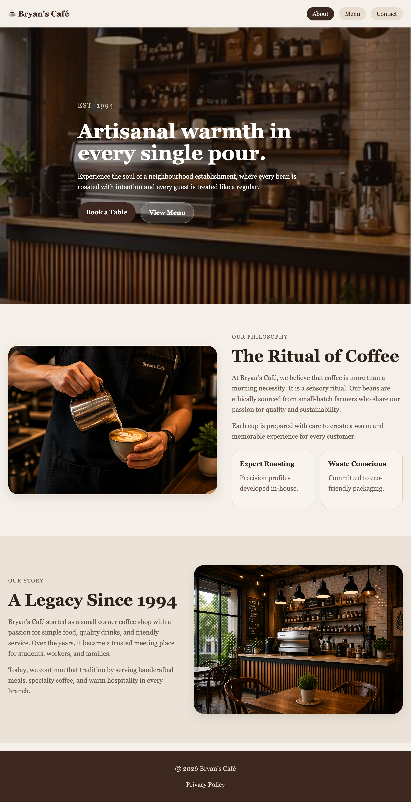
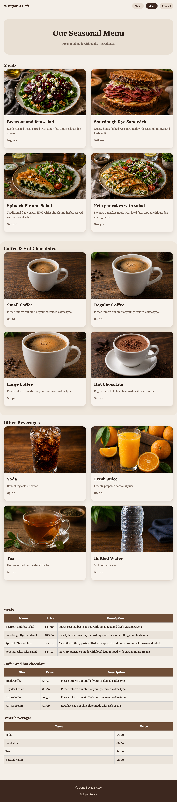
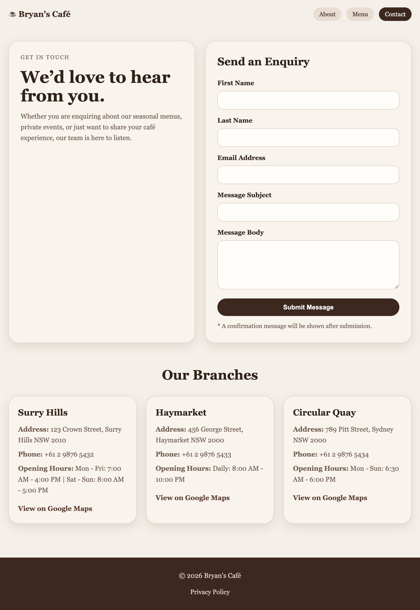
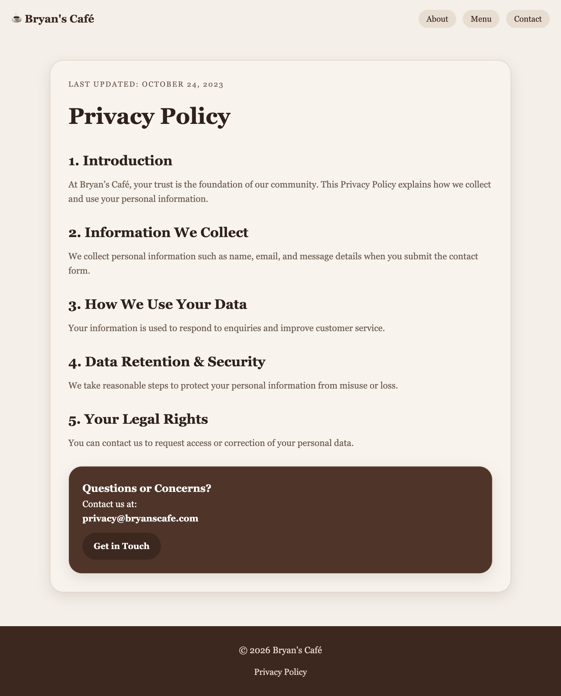
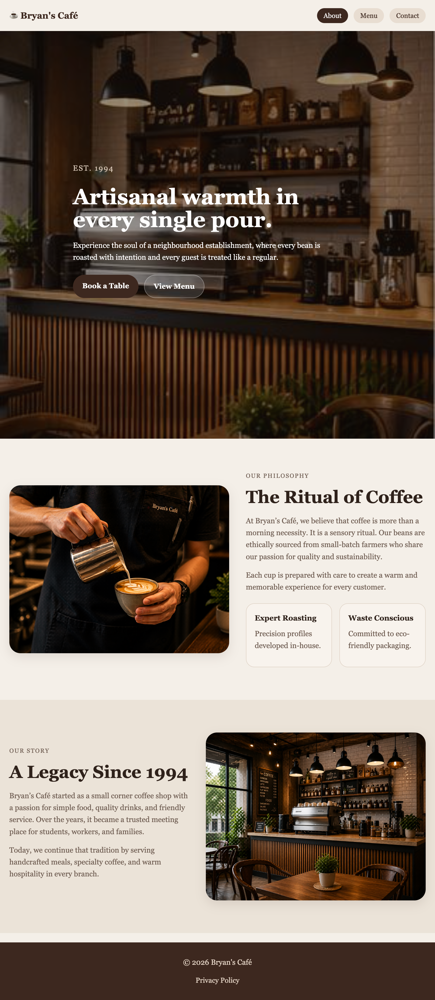

# Bryan's Café

## Project Overview

Bryan's Café is a responsive multi-page website developed as part of my Information Technology studies at the Australian College of Business Intelligence (ACBI).

The project focuses on front-end web development, responsive design, web accessibility and user-friendly navigation.

## Live Demo

[View the live website](https://joycebarros16.github.io/bryans-cafe/)

## Technologies Used

- HTML5
- CSS3
- JavaScript
- XML
- DTD
- Git & GitHub

## Key Features

- Responsive website layout
- Mobile-friendly navigation
- Café menu
- Contact page
- Privacy policy page
- Structured XML data
- Web accessibility

## Screenshots

### Homepage

### Menu Page

### Contact Page

### Privacy Policy

### Mobile Responsive Design

## How to Run the Project

1. Clone or download this repository.
2. Open the project folder in Visual Studio Code.
3. Run the website using the Live Server extension.

## Project Purpose

This academic project demonstrates my practical skills in front-end development, website organisation and responsive web design.

## Author

Joyce Barros Teixeira
Information Technology Student | Front-End Web Developer
Sydney, Australia
